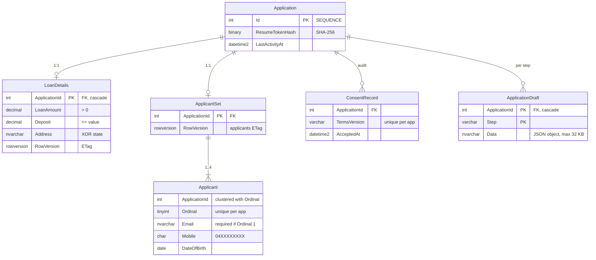
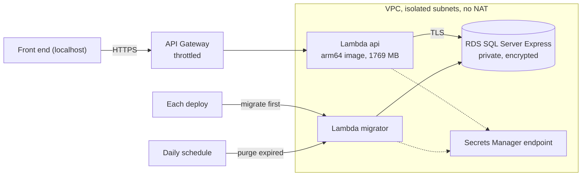

# Notes

All three parts are done; CI deploys to AWS on every push to `main`. Detail for each phase, including what changed from the plan, is in [`docs/plans/`](docs/plans). How to run and test it is in the [README](README.md).

## 1. Decisions and edge cases

| Topic | Decision |
|---|---|
| "More than two" | 3 sections to start, add up to 4 (`maxApplicants` in config), remove down to 3. The server enforces the same range. |
| Count changed later | Going from 2 applicants to 1 keeps applicant 2 in the draft but doesn't send them; going back to 2 restores them. |
| Back / leaving | Every step autosaves a **draft to the server** as you type (1 s after a pause, and when the tab hides). Back, a refresh, or closing the browser loses nothing (added after the brief). |
| Each visitor | Gets their own application (`POST`), plus a random **resume token** kept in `localStorage`. Every request needs the token. A wrong or expired token returns `404`, so ids can't be probed. |
| Terms | A `<dialog>`, with consent stored together with a **terms version**. A new version asks the customer to agree again. |
| 18 or older | Checked against today's date in **Australia/Sydney**, not UTC. Boundaries tested: the 18th birthday today and tomorrow, 29 Feb, future dates, over 120. |
| Mobile | Accepts `0412 345 678`, `+61…` and `(04) …`; **stored as `04XXXXXXXX`**. |
| Email | Required for applicant 1 only. Duplicates are allowed (couples share inboxes). |
| Hidden answers | Answers to questions that weren't asked (deposit when not buying, address *and* state) are **rejected** by the server, not dropped. |
| Not saved yet | `GET` returns `404`, which the client treats as "empty". |
| Rules on both sides | The same rule functions are used on the client (for UX) and the server (as the source of truth), with the same boundary tests in both. |
| Submit | Saving About you submits the application. A completion screen shows a reference (`HL-<id>`) and "Start a new application" (added after the brief). |
| Address | Addressfinder suggestions, called from the browser with the public key; an unlisted address can still be typed in full (added after the brief). |

## 2. Part 1 refactor

| Changed | Why |
|---|---|
| `JourneyService` and a `JOURNEY` token replace the hard-coded next route | Steps don't know their neighbours. Adding a step is one entry (`.claude/skills/add-journey-step`). |
| Runtime `config.json`; the mock is registered only when `useMockApi` is set | One build runs against the mock, Docker or AWS. |
| Shared `StepCard`, `StepActions`, `isInvalid`, `toErrorMessages` | Every step would otherwise copy them. |
| `ApplicationStore` with cached resources | The step, its guard and the nav load the data once. |
| `ApplicationResourceClient` with ETag / `If-Match` | Concurrency is handled once, for every step. |
| angular-eslint (`OnPush`) and Prettier in CI | Stops drift. |

**Left alone:** the reference-data enums (their codes are shared with the database), the mock router, and Loan details' conditional-field logic. They work and are tested; rewriting them would be churn.

## 3. API

- **Layers:** Domain, then Application (handlers, FluentValidation, `Result<T>`), then Infrastructure (Dapper, unit of work), then Api (minimal APIs). Dependencies point inward.
- **Errors map to:**

  | Case | Status |
  |---|---|
  | Validation failure | `400`, with per-field keys such as `applicants[1].mobile` |
  | Missing resource or wrong token | `404` |
  | Applicants saved before loan details | `409` |
  | Update without `If-Match` | `428` |
  | Stale ETag | `412` |
  | Deadlock | `503` |
  | Anything else | `500` ProblemDetails with a correlation id |

- **Also:** JSON logs with correlation ids, health checks, options validated at start-up, warnings as errors.
- **Left out:**
  - MediatR (commercial licence);
  - a generic repository (it hides the SQL Dapper makes explicit);
  - API versioning (one client);
  - sign-in (see Improvements).

## 4. Database

- **Schemas:**
  - `ref` holds lookup tables with foreign keys. Their codes match the front-end enums, and a test checks that.
  - `app` holds the application data.
- **The schema enforces the rules itself** (named `CHECK` constraints, each broken by a test):
  - address *or* state, never both;
  - a household answer only when there's more than one applicant;
  - deposit no more than the property value;
  - the primary applicant's email;
  - mobiles in the normalised format.
- **Not in the schema:**
  - "18 or older" (it needs today's date);
  - "deposit only when buying" (it would hard-code purpose codes).
- **Indexes:**
  - Every query is by `ApplicationId`, which is the primary key or the leading key of every table.
  - Applicants are clustered on `(ApplicationId, Ordinal)`, so one application's set is a single seek.
- **Access:** the API connects as `homeloan_app`, which can read and write data but not change the schema (a test proves `CREATE TABLE` is denied). DbUp runs the migrations. `READ_COMMITTED_SNAPSHOT` is on.
- **Drafts** live in their own table, so half-filled answers never relax the real constraints. A successful save deletes the step's draft in the same transaction.

**Transactions and concurrent saves**

- **One `rowversion` per resource, exposed as its ETag.**
  - The applicants' version sits on `ApplicantSet`, not on `Application`.
  - Otherwise saving Loan details would invalidate the applicants ETag, causing a false `412` (ai-log #4).
- **Each save is compare-and-swap in one transaction:** `UPDATE … WHERE RowVersion = @expected`, then a `MERGE` of the applicants scoped to that application, then a consent row if the terms version is new, then commit. If no row matches, the save rolls back at once and returns `412`.
- **Two first saves at once:** the loser hits the primary key and gets `412` or `428`.
- **Drafts are last write wins.** An autosave never blocks anyone, and Continue waits for any draft save in flight (ai-log #17).
- **Tested for real:** concurrent PUTs against SQL Server, 20 rounds in CI, must give exactly one winner.

## 5. AWS

- **Lambda:**
  - The same ASP.NET app as locally (`AddAWSLambdaHosting`), packaged as arm64 container images and ReadyToRun-compiled.
  - Both images were checked under AWS's Runtime Interface Emulator before deploying, which found a Lambda-only bug (ai-log #8).
- **Reaching the database:**
  - Everything is in isolated subnets, with no NAT and no internet route.
  - Security groups allow only Lambda → 1433 and Lambda → the Secrets Manager endpoint on 443.
  - TLS with the server certificate validated against the RDS CA, which is pinned by checksum.
- **Secrets:**
  - The passwords are generated by RDS and Secrets Manager, and never appear in code, environment variables or GitHub.
  - The Lambdas get only the secret ARNs and read the secrets at start-up.
  - The API can read only its own login's secret; a template test proves it can't read the admin one.
- **IAM:**
  - Each Lambda's role covers its own logs, the VPC and its secrets.
  - GitHub deploys through OIDC, using GitHub's immutable subject. The deploy role is limited to this repo's `aws` environment (only `main` may use it) and can only assume the CDK roles.
- **Database choice:**
  - **RDS SQL Server Express:** the same engine as local, so the migrations, `MERGE`, `rowversion` and the integration tests carry over unchanged. It's also the cheapest SQL Server.
  - Aurora Serverless would mean changing dialect.
  - Production would use Standard edition, Multi-AZ and RDS Proxy.
- **Deploys:**
  - Every push to `main` runs the checks, then `cdk deploy`.
  - The migrator runs before the new API version goes live, so a failed migration rolls back the deploy.
  - Then come the smoke test and the Playwright journeys against the live API.
- **Cold starts** went from about 2 s to none for normal traffic. Measured with `scripts/measure-cold-start.sh`:
  - 1769 MB (one full vCPU);
  - the secret fetch overlapped with start-up (it was 718 ms of 1.1 s);
  - one provisioned instance (about US$15–20/month; `apiProvisionedConcurrency` in `infra/cdk.json`).
- **Cost:** about US$11–45/month, plus the provisioned instance. The Destroy workflow removes it all.

## 6. Improvements

- **Sign-in** (Cognito), linking the application to an account; move the token into an `HttpOnly` cookie once the front end shares the API's domain.
- **Lock submitted applications:** a status column and read-only routes.
- **Per-lender configuration:** grow `config.json` and the journey token into steps, fields and rules served by the API.
- **Serve shared rules from the API** (`GET /api/config`) so the applicant cap and terms version can't drift between client and server.
- **Store the address's G-NAF id**, and verify the address on the server.
- **Show server errors next to their fields.**
- **Applicant ids per person**, not per position.
- **Production hardening:**
  - deletion protection, Multi-AZ, RDS Proxy, secret rotation;
  - a narrower CloudFormation execution role;
  - alarms routed to email.
- **Hosting:** the front end on S3 and CloudFront, with CORS locked to that origin.
- **Generated client types:** TypeScript models from the OpenAPI document.

## 7. AI tools

- **Tool:** Claude Code (Anthropic), for the code, tests, infrastructure, CI investigations and docs.
- **Way of working:**
  1. Plan first (`docs/plans/`), reviewed by me.
  2. Small commits, with tests.
  3. Mutation checks on the important tests.
  4. Verification the way production runs: the browser, the Lambda emulator, real SQL Server, the live deploy.
- **Context:** `CLAUDE.md` files hold the conventions and an AWS safety rule; a repo skill covers adding steps.
- **[`docs/ai-log.md`](docs/ai-log.md)** lists **18 real cases** where the AI was wrong, and how each was caught. Examples:
  - **Design:** one version shared by every resource would have caused false `412`s (#4). An autosave could have landed after the real save (#17).
  - **Tests that couldn't fail:** an assertion-free spec, and a test that passed with the feature deleted (#2, #3). A mutation check exposed the second.
  - **Platform:** a disposal bug only on Lambda (#8), GitHub's OIDC subject format (#11), and a start-up hook that never fires on Lambda (#13).
  - **Safety:** a `cdk synth` ran under the wrong AWS profile. AWS denied it, and a wrapper now refuses any other account (#10).
- **Lesson:** the checks that ran the code the way production does (the emulator, real SQL, concurrent requests, the live deploy) caught what unit tests didn't.
