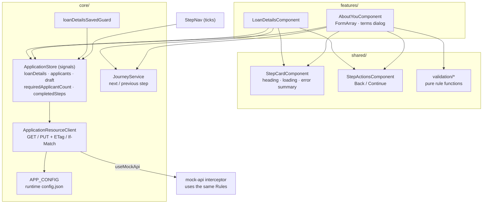
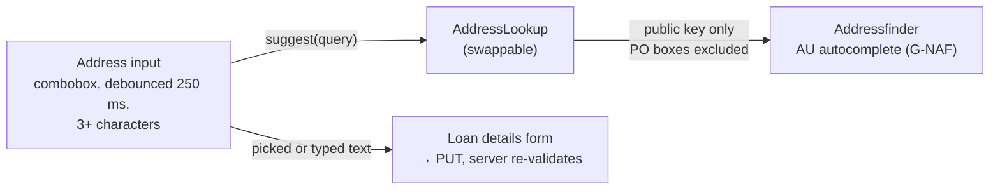
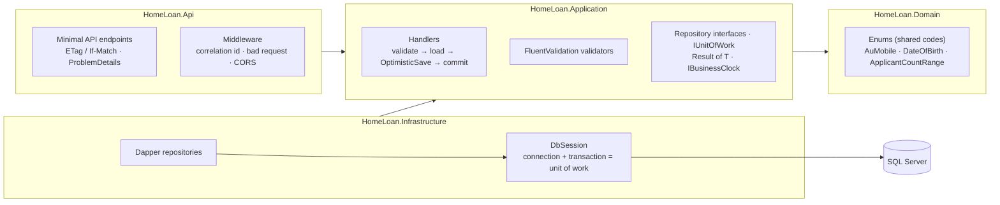
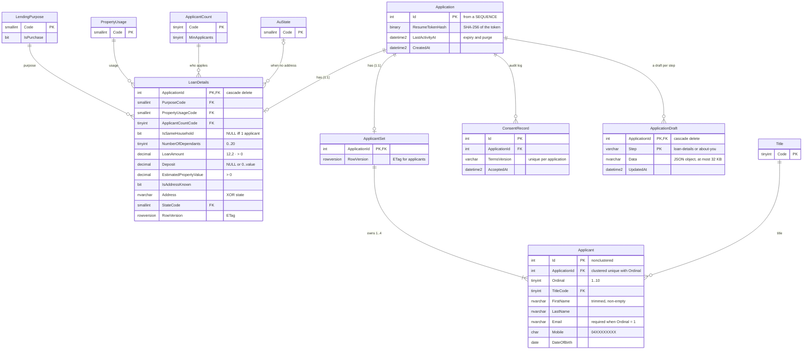
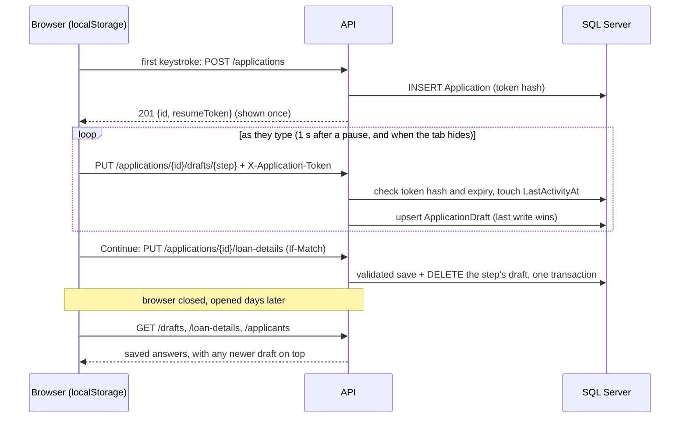
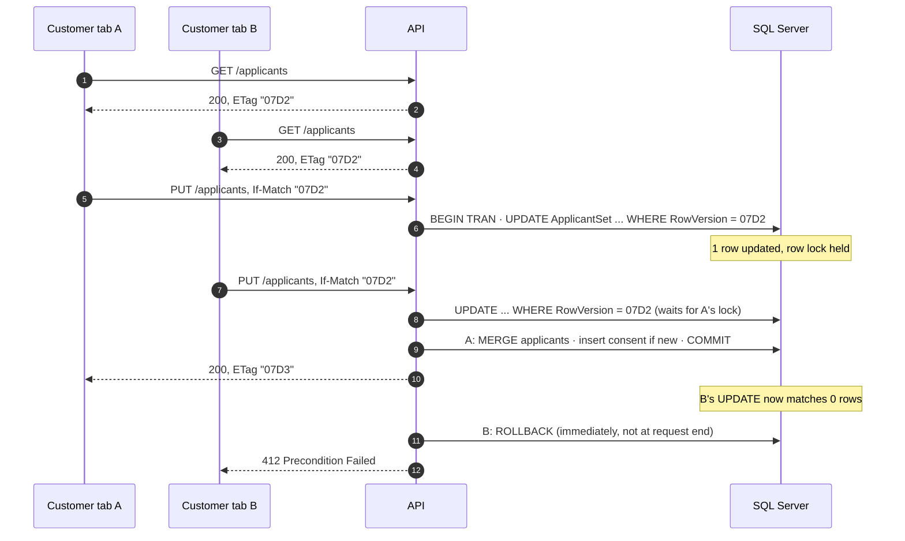
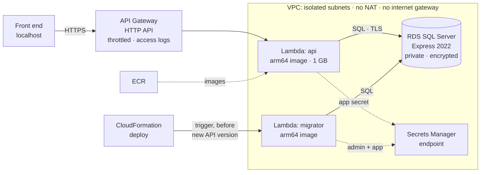
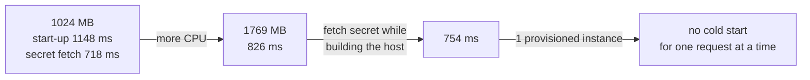
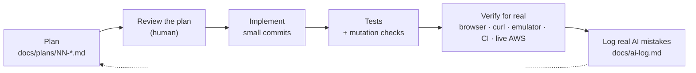

# Notes

How the exercise was approached, the decisions and why, the database and AWS design, what I'd do next, and how AI tools were used. The plan for each phase (written before the code, with "As built" sections listing every difference) is in [`docs/plans/`](docs/plans).

**Status:** all three parts are done, and all checks pass in CI.

- **Part 1:** the About you step, a refactor of Loan details, and tests.
- **Part 2:** the .NET API with SQL Server and Dapper, run with Docker Compose; unit, integration and E2E tests.
- **Part 3:** the API on AWS Lambda, deployed automatically on every push to `main`.

Unfinished work and improvements are in [section 8](#8-improvements-and-unfinished-work).

---

## 1. Decisions and assumptions

| Topic | Decision | Why |
|---|---|---|
| **"More than two" applicants** | Start with **3** sections; "Add another applicant" up to **4** (configurable `maxApplicants`); remove down to 3. The server enforces the same range. | Three is the smallest number that is "more than two". A cap stops unbounded input. 4 is a common lender limit, and it's config, not code. |
| **Changing the count afterwards** | If Loan details goes from 2 applicants to 1, applicant 2 is **kept in memory but not submitted**; going back to 2 restores them. The server replaces the whole set on save. | No surprise data loss, and no stale applicant reaches the server. |
| **Saving progress and coming back** | Answers are **saved to the server as the customer types** (1 s after a pause, and at once when the tab is hidden or closed), valid or not, as a per-step **draft**. Closing the browser and coming back restores them and opens the furthest step. Back works the same way. See [Drafts and resuming](#drafts-and-resuming). | Asked for after the brief: people fill a loan form in several sittings. The brief's "Back keeps input" falls out of the same mechanism. |
| **Terms** | A native `<dialog>` with placeholder text. "I agree" ticks the checkbox. Consent is sent with a **terms version**, and the customer must agree again when the version changes. | `<dialog>` gives focus trapping and Esc without Bootstrap JS. Versioned consent gives an audit trail. |
| **18 or older** | Age is calculated from the date in **Australia/Sydney** (server, via `TimeProvider`), and dates are parsed as local dates (client). Boundaries tested: birthday today, tomorrow, 29 Feb, future dates, over 120. | Otherwise someone turning 18 today is rejected on a Sydney morning (UTC is still on yesterday), and `new Date('yyyy-MM-dd')` is off by a day in some time zones. |
| **Mobile** | Accept `0412 345 678`, `+61 412 345 678`, `61412345678` and `(04) 1234-5678`, and **store `04XXXXXXXX`**. | People type mobiles many ways; one stored format. |
| **Email** | Required for the primary applicant, optional for others, validated whenever present. Duplicate emails across applicants are allowed. | Couples often share an inbox; rejecting duplicates is a lender policy decision. |
| **Application id** | **Each visitor gets their own application**, created with `POST` when they first type. The server picks the id (a SQL `SEQUENCE`) and returns a random **resume token** once. Every request for the application must carry it; the server stores only its hash. | Drafts are personal data that can be reopened, so only the browser that started an application may reach it. A wrong, missing or expired token answers `404`, the same as a missing application, so ids can't be probed. |
| **"Not saved yet"** | `GET` returns **404**, not `200 null`. The front-end client maps 404 to `null`, and the mock does the same. | Standard REST. The brief invited contract improvements. |
| **Hidden answers** | Answers to questions that weren't asked (household for one applicant, deposit when not buying, address *and* state) are **rejected** by the server, not silently dropped. | "Never trust the client." |
| **Rules on both sides** | Mobile, age, email and length rules are pure functions on the front end (shared by the form and the mock) and mirrored in `HomeLoan.Domain`, with **the same boundary tables in both test suites**. | Client rules are for UX; the server is the source of truth. |

---

## 2. Part 1: the front end and the refactor

**Improved, and why:**

| Before (starter) | After | Why |
|---|---|---|
| `goToNextStep()` hard-coded `'/loan-details'` | `JourneyService` with next and previous steps, from an injectable `JOURNEY` token | Steps don't know their neighbours; tests (and later, per-lender journeys) supply their own steps. |
| `API_BASE_URL = '/api'` constant; mock always on | **Runtime `config.json`**, loaded before bootstrap; the mock interceptor is registered only when `useMockApi` is true | One build runs against the mock, Docker or AWS. The mock never intercepts a real API. |
| Per-component `isInvalid`, `toErrorMessages`, card, alert and footer markup | `isInvalid()`, `toErrorMessages()` (handles the mock's `string`, ASP.NET's `string[]`, ProblemDetails, 412/428, network errors), `StepCard` and `StepActions` | Every step was going to copy these. |
| Each step fetching its own data | `ApplicationStore` with `CachedResource` (shares in-flight requests, retries failures) | About you, its guard and the step nav all need Loan details; they fetch it once. It's also where the Back draft lives. |
| A service per resource building URLs | `ApplicationResourceClient`, with **optimistic concurrency** (ETag from GET/PUT, sent back as `If-Match`) | Concurrency is solved once, for every step. |
| No linter; four files not formatted | angular-eslint (enforcing `OnPush`), Prettier checked in CI | Stops drift. |

**Left alone, on purpose:** the reference-data enums and their codes (shared with the database seed), the regex-based mock router, `mockDb`, and Loan details' conditional-field logic (`syncConditionalFields`). These work, are tested, and changing them would have been churn without benefit.

**Added after the brief: property address suggestions** ([plan](docs/plans/05-address-autocomplete.md)).

- **Called from the browser** with Addressfinder's public key. Addressfinder checks the calling domain; the secret is only for server-to-server calls, and it's never used or stored.
  - The API's Lambda has no internet route, so a server-side proxy would have needed a NAT gateway.
- **Our own combobox**, not the vendor widget. It's a `ControlValueAccessor` in the reactive form, `OnPush`, and follows the ARIA pattern: Up, Down, Enter, Escape, and `aria-activedescendant`.
- **A suggestion is a convenience, never a gate.**
  - An unlisted address (a new build, vacant land) can be typed in full.
  - Errors and timeouts (5 s) just mean no suggestions.
  - With no `addressFinderKey` in `config.json`, the field is a plain input.
- **Tests:** unit tests for the lookup, the component and the config. One Playwright journey picks a suggestion with the keyboard.
  - Every journey blocks the real service, and this one stubs it with `page.route`, so CI never depends on, or spends quota at, the vendor.
  - It was also checked by hand against the real service.
- **Found while planning it:** the mock interceptor matched by path only, and Addressfinder's path also starts with `/api/`. It now matches the origin too, with a test that fails without the fix.
- **Next:** store the G-NAF id, state and postcode (a migration), and verify them server side with the secret. Lock the key to the real domains once the front end is deployed.

**Not built:** a metadata-driven form engine. The config (`maxApplicants`, `termsVersion`, the journey token) is the first step towards per-lender configuration; see Improvements.

---

## 3. Part 2: the API

- **Dependencies point inward.** The domain has no framework references, and Infrastructure implements Application's interfaces.
- **Handlers validate first**, so no entry point can skip validation. They return `Result<T>` instead of throwing for expected failures, and endpoints map the result to HTTP:

| Outcome | HTTP |
|---|---|
| Created / updated | `201` + `Location` / `200`, both with `ETag` |
| Not saved yet | `404` ProblemDetails |
| Field errors | `400` `ValidationProblemDetails`, keys such as `applicants[1].mobile` |
| Wrong, missing or expired resume token | `404` (the same as no such application) |
| Applicants before Loan details | `409` |
| `If-Match` missing (resource exists) | `428` |
| Stale `If-Match`, or `If-Match` on a resource that doesn't exist | `412` |
| Malformed JSON | `400` (in every environment, logged at Information) |
| Deadlock or timeout | `503` + `Retry-After` |
| Anything else | `500` ProblemDetails with a correlation id, no stack trace |

- **Production touches:**
  - JSON logs with a correlation id on every line, echoed in responses and errors.
  - `/health/live` and `/health/ready` (the latter checks the database).
  - Options validated at start-up.
  - Warnings as errors with analyzers on; central package versions.
  - Swagger in Development.
- **Left out, with reasons:**
  - **MediatR:** commercial licence since 2025; plain handlers give the same structure.
  - **Generic repository:** it hides the SQL that Dapper exists to make explicit, and can't express the set-replacing save.
  - **FluentAssertions:** commercial since v8.
  - **API versioning:** one client.
  - **Auth:** out of scope; see Improvements.

---

## 4. Database design

**Schema choices:**

- **Two schemas.**
  - `ref` holds lookup tables whose codes equal the front-end enums. A test checks the seeds against the C# enums.
  - `app` holds application data.
  - Lookups are tables with foreign keys rather than `CHECK (… IN …)`: adding a title is an `INSERT`, and facts about a code (`IsPurchase`) live next to it.
- **Every constraint is named** (`CK_LoanDetails_AddressOrState`, `UX_Applicant_ApplicationId_Ordinal` and so on). Errors are readable, and later migrations can refer to them.
- **The database protects itself.** These rules are enforced in the schema, so they hold whatever the API does:
  - **Address or state:** exactly one of them.
  - **Household answer:** asked only when more than one person applies.
  - **Deposit:** no more than the property value.
  - **Primary applicant:** must have an email.
  - **Mobile:** stored normalised.
  - **Names:** non-blank.
  - **Ordinal:** within 1–10.

  A schema test breaks each rule with raw SQL to prove it.
- **Deliberately not in the schema:**
  - **"Deposit only when buying":** it would hard-code purpose codes into a `CHECK`. The validator uses `IsPurchase`.
  - **"18 or older":** it needs today's date.
- **Indexes:**
  - Every query is by `ApplicationId`, which is the primary key or the leading key everywhere.
  - Applicants are **clustered on `(ApplicationId, Ordinal)`**, so a set is stored together and read with one seek. The identity `Id` is a non-clustered key.
  - The `ref` foreign keys have no indexes, because those tables are tiny and never deleted from.
- **Migrations:** DbUp runs versioned scripts, one transaction each, journaled. An idempotent "always" script creates the **`homeloan_app` login with data-only rights** (`SELECT/INSERT/UPDATE/DELETE` on `app`, `SELECT` on `ref`). The API connects as that login, and a test proves `CREATE TABLE` is denied.
- **`READ_COMMITTED_SNAPSHOT` is on,** so reads never wait on writes.

### Drafts and resuming

([plan](docs/plans/06-server-drafts.md))

- **Drafts are kept apart from the validated tables.** A half-filled form can't weaken their constraints. A draft is only checked for being a JSON object of at most 32 KB, for a known step.
- **Last write wins for drafts**, not `If-Match`: an autosave conflict between two tabs shouldn't interrupt anyone. The real save keeps its `412` protection.
- **No autosave can land after the real save.** Continue waits for any draft save in flight, and saves strictly in order. A late draft would recreate a stale copy that wins on the next visit (ai-log #17).
- **Where the token lives:** in `localStorage`, sent as a header.
  - An API cookie would be a third-party cookie here, because `localhost` and `execute-api.amazonaws.com` are different sites, and browsers block those.
  - The API already accepts the token as a cookie too. Once the front end and `/api` share a domain, it becomes an `HttpOnly` cookie, which XSS can't read.
- **Seven days:** an application unused for 7 days can't be resumed.
  - A daily scheduled run of the migrator Lambda (EventBridge) deletes drafts of inactive applications, and inactive applications that were never finished. Finished ones stay as the lender's record.
  - One `cdk.json` setting (`resumeExpiryDays`) drives both the API and the purge.
- **Shared computers:** "Not you? Start a new application" forgets the application on that device. It doesn't delete it: its owner may want it, nobody can reach it without the token, and an unfinished one is purged.

### Transactions and concurrent saves

- **One version per resource.** Each resource has its own `rowversion`, sent to the client as a quoted-hex **ETag**.
  - The applicants' version lives on `ApplicantSet`, not on `Application`. Otherwise, saving Loan details would invalidate the applicants ETag, and Back, then Continue, then saving would give a false `412` (ai-log #4).
- **The guard is compare-and-swap inside the transaction.** In the diagram, ETags are shortened; real ones are 16 hex digits, such as `"00000000000007D2"`.

- **The applicants save, in one transaction:**
  1. Check Loan details exist (`409` if not) and that the count matches them.
  2. Compare-and-swap on `ApplicantSet`. This takes a row lock, so saves for one application are serialised.
  3. **`MERGE` by position:** update matching ordinals (ids stay stable), insert new ones, delete the rest. The `MERGE` target is a CTE filtered to the one application, so its delete clause can never reach another application's rows.
  4. Insert a `ConsentRecord` only for a terms version not yet agreed. Re-agreeing keeps the original time.
  5. Read the set back inside the transaction, then commit.
- **A first save that loses a race** hits the primary key (error `2627`) and gets `412`.
- **Tested for real:** two concurrent PUTs with the same ETag must produce exactly one `200` and one `412`, and the stored row must be the winner's. The same goes for two concurrent first saves (`201` + `412`). Each race runs 20 rounds against SQL Server in CI. That test found a real bug, ai-log #7.

---

## 5. Part 3: AWS design

**How the API runs on Lambda.** The same code runs locally and on Lambda: `AddAWSLambdaHosting` does nothing under Kestrel, and on Lambda it serves API Gateway events. Packaging:

- **Container images, as requested.** The same Dockerfile has `lambda` and `migrator-lambda` targets on AWS's .NET 8 base image.
- **arm64 without emulation.** The SDK stages cross-compile, so the arm64 images build on x64 CI runners natively.
- **Faster starts:** the API is ReadyToRun-compiled.
- **Checked before deploying:** both images run locally under AWS's Runtime Interface Emulator. That check found a Lambda-only disposal bug before anything was deployed (ai-log #8).

**How it reaches the database.**

- **Network:** the Lambdas sit in isolated subnets with RDS. Security groups allow exactly Lambda → SQL Server on 1433 and Lambda → the Secrets Manager endpoint on 443.
- **No internet path:** there's no NAT gateway (saving about US$45 a month), and nothing needs the internet.
- **TLS:** connections are encrypted with **certificate validation**. The image trusts Amazon's RDS CA bundle, pinned by checksum.

**Secrets.**

- **Generated, never in plain config:**
  - The admin password is generated by RDS.
  - The app login's password is generated by Secrets Manager, excluding characters that would break a connection string.
  - Neither appears in code, environment variables or GitHub.
- **Resolved at start-up:** each Lambda gets only the secret's **ARN** and the database host. `HomeLoan.Secrets` reads the secret at start-up and builds the same connection string the app uses locally, so nothing else knows where it came from.
- **Error messages** never include secret contents (tested).

**IAM, least privilege.**

| Principal | Can |
|---|---|
| API Lambda role | Write its logs, use VPC network interfaces, and `GetSecretValue` on **the app login secret only** (a template test proves it can't read the admin secret) |
| Migrator Lambda role | The same, plus the admin secret |
| `homeloan-github-deploy` (GitHub OIDC) | Assume the four CDK bootstrap roles, **nothing else**. It's trusted only for tokens from this repo's `aws` environment, which only `main` may deploy to, using GitHub's immutable subject (`repo:owner@id/repo@id`), so a renamed or re-created repo can't match. |
| CDK CloudFormation execution role | Bootstrap default (AdministratorAccess). Tightening it is an improvement. |

**Which database, and why: RDS SQL Server Express.**

| Option | Verdict |
|---|---|
| **RDS SQL Server Express** ✅ | **The same engine and version as local** (2022). The migrations, `MERGE`, `rowversion`, `OPENJSON`, `READ_COMMITTED_SNAPSHOT` and the logins work unchanged, and integration tests run against the same engine as production. Cheapest SQL Server: free-tier eligible on `db.t3.micro`. |
| Aurora Serverless v2 | Scales to zero and fits Lambda well, but it's PostgreSQL or MySQL only, so the dialect and the tests would change. |
| RDS Standard/Enterprise, Multi-AZ | What production would use (with RDS Proxy for Lambda connection pooling); far too expensive for an exercise. |

**Exercise settings I'd change for production:**

- RETAIN the database on stack deletion, turn on deletion protection, take a final snapshot, and enable Multi-AZ.
- Add RDS Proxy.
- Secret rotation.
- A Secrets Manager endpoint in every AZ.

**Cold starts: measured, then reduced in three steps.** Each step went through the normal pipeline and was measured from CloudWatch with `scripts/measure-cold-start.sh`. The API logs its own start-up phases, and Lambda's `REPORT` lines give the init and first-request times.

| Step | Lambda init | Our start-up code | First request after init |
|---|---|---|---|
| 1024 MB (baseline) | 1.1–1.5 s | 1148 ms, of which **718 ms is the secret fetch** | 549 ms |
| 1769 MB (one full vCPU) | ~1.0 s | 826 ms (secret fetch 520 ms) | 336 ms |
| Start the secret fetch before building the host | about the same | 754 ms | ~380 ms |
| One provisioned-concurrency instance on the `live` alias | done ahead of time | — | **39 of 39** deploy-check requests had no cold start |

- Start-up figures are medians over 10 instance starts; init and first-request figures come from only 2–4 user-facing cold starts per step, so read them as ranges.
- **A user-facing cold start went from about 2 s to about 1.35 s, and to none for one-at-a-time traffic.** The first start after a deploy used to take about 7 s while Lambda cached the new image. Provisioned concurrency now does that during the deploy.
- **The secret fetch was the biggest cost:** the AWS SDK's first call, which loads the SDK, resolves credentials and the endpoint, and opens TLS. Overlapping it saved ~70 ms, not the 0.2–0.3 s I had estimated (ai-log #15). It's CPU-bound, and at this size Lambda has about one vCPU.
- **The limit of one instance:** About you loads Loan details and applicants in parallel, so one user can need two instances, and the second request is an on-demand cold start (seen once in the deploy checks). Two instances would cover one user, at twice the cost.
- **Cost:** about US$15–20 a month for the provisioned instance. Set `apiProvisionedConcurrency` to `0` in `infra/cdk.json` and push to turn it off. Memory stays at 1769 MB, which costs little at this traffic.
- **Next options, not done:**
  - Read the secret with a plain signed HTTP call instead of the SDK.
  - Native AOT (Dapper would need Dapper.AOT).
  - A zip package with SnapStart (not available for container images).

**Cost while running:** roughly US$11 a month if RDS is free-tier eligible, otherwise about US$45, plus about US$15–20 while the provisioned instance is on. Most of it is the Secrets Manager endpoint and RDS. A budget alarm is built in but off (no email set); the Destroy workflow ends all charges.

### Deployment pipeline

- **Fully automatic, as asked.** Every push to `main` runs the checks, then `cdk deploy` (build images → push to ECR → migrate → switch the API), then a smoke test, then the **same Playwright journeys against the live API**.
- **Pinned and offline-safe:**
  - The CDK CLI version is pinned.
  - Synth needs no credentials, because availability zones are committed in `cdk.context.json`.
  - Locally, `infra/cdk.sh` refuses any account but the target.
- **The first real deploys caught two problems that only a live run could** (ai-log #11 and #12):
  - GitHub's immutable OIDC subject didn't match the trust policy, so sign-in failed.
  - CORS didn't allow the test origin.

---

## 6. Testing strategy

| Layer | Count | Runs against |
|---|---|---|
| Front end unit (Karma) | 110 | Components, validators, store, client, mock API |
| Back end unit (xUnit) | 84 | Domain rules, validators, handlers with fakes, ETags, secrets |
| Back end integration (xUnit) | 47 | **Real SQL Server** (Testcontainers) and the real API (WebApplicationFactory), as the least-privilege login |
| Infra (CDK assertions) | 9 | Synthesized CloudFormation |
| Playwright journeys | 6, **run three ways** | In-browser mock · Docker Compose (.NET + SQL Server) · the live AWS API |
| Lambda emulator check | script | Both Lambda images with real API Gateway events |
| Smoke test | script | The live API after every deploy |

- **The same boundary tables in both stacks:** mobile formats, birthday today, 29 Feb and so on.
- **Mutation checks on the tests that guard important behaviour.** A test that can't fail is worse than no test:
  - the hidden-applicant draft;
  - secret scoping in the infrastructure.

---

## 7. Assumptions about the environment

- The app is single-tenant, with one application per browser and no auth (as in the starter).
- Terms text is placeholder; the version is `2026-10`, set in both the front-end and API config.
- **AWS:**
  - The account is `085843960390` in Sydney (`ap-southeast-2`).
  - The front end isn't deployed; it runs locally against the API (the brief allows this).
  - CORS allows `localhost:4200` (dev) and `localhost:4300` (Playwright).

---

## 8. Improvements and unfinished work

**Product:**

- **Per-lender configuration.** Grow `config.json` and the `JOURNEY` token into lender metadata: steps, fields, rules and applicant limits served by the API. That's the natural path towards a metadata-driven loan app.
- **Show server field errors next to the field.** Keys like `applicants[1].mobile` already arrive; today they're listed in the summary.
- **Serve the applicant cap and terms version from the API** (`GET /api/config`), so the front end and server can't drift. Today they're set in both places.
- **Applicant identity.** Ids are stable per position, not per person, so removing applicant 2 of 4 shifts applicant 3 into position 2. Fixing it needs the client to send ids.

**Platform:**

- **Authentication:** Cognito or a JWT authorizer on API Gateway, with an application linked to the account at sign-up. Today it's an anonymous resume token, and moving it into an `HttpOnly` cookie once the front end shares the API's domain.
- **Database hardening:** RDS Proxy, Multi-AZ, deletion protection with snapshots, secret rotation, and column encryption for date of birth and mobile.
- **Narrower deploy role:** tighten the CDK CloudFormation execution role (`--cloudformation-execution-policies`).
- **Cold starts:** one provisioned instance is on (see AWS design). Next would be a second instance for parallel loads, or a lighter secret fetch.
- **Alerting:** route the error alarm to SNS or email, and turn on the budget alarm (`budgetEmail` in `infra/cdk.json`).
- **Front end:** deploy it to S3 and CloudFront, and lock CORS to that origin.
- **Generated client types:** generate the TypeScript models from the OpenAPI document instead of keeping them in step by hand.
- **Logging and access:** log-based metrics on correlation ids, and IAM Identity Center for people instead of an IAM user's access key.

**Unfinished:** nothing from the brief. (Fixed after a manual test: each deploy's E2E run used to reset application `1` on the live API, wiping hand-entered data, ai-log #16. Since server drafts, every browser, and so every test, gets its own application.)

---

## 9. AI tools and how they were used

**Tools:**

- **Claude Code (Anthropic), in the Claude desktop app** for almost all code, tests, infrastructure, docs and the CI investigations.
- **GitHub CLI and AWS CLI,** driven through it.
- **Playwright and the app's built-in browser** for checking the UI.

**Workflow:** the same plan-first loop I described in the interview, made visible in the repo.

- **Context for the AI:** `CLAUDE.md` files (root, front end, back end) hold the conventions, the commands and an AWS safety rule.
- **Repeatable changes:** a repo skill (`.claude/skills/add-journey-step`) makes "add a step" or "add a field" changes predictable.
- **Plans updated, not replaced:** each plan has an "As built" section listing every difference from it, with the reason.

**Where the AI was wrong, and how it was caught.** There are 17 real entries in [`docs/ai-log.md`](docs/ai-log.md), none invented. By type:

| Type | Examples | Caught by |
|---|---|---|
| **Design gaps** | Undershooting the brief with "keep it simple" (#1); one concurrency version shared by every resource, which would give false 412s (#4); test runs resetting the application people demo with (#16); an autosave able to land after the real save (#17) | Plan review against the brief; tracing the Back/Continue journey; a manual test; a unit test written for the race |
| **Tests that couldn't fail, or only one way to pass** | An assertion-free spec (#2); a test that passed with the feature deleted (#3); a race test that accepted only one of two correct interleavings (#14) | Self-review and a mutation check |
| **Environment-specific bugs** | Malformed JSON giving 500 in Development only (#5); error-level log noise from client mistakes (#6); a race only seen on CI (#7); the Lambda adapter disposing request scopes synchronously (#8) | curl smoke tests, reading test output, the CI logs, the Lambda emulator |
| **Wrong assumptions about the platform** | Time-zone data missing from the Lambda image (#9); GitHub's OIDC subject format (#11); CORS for the test origin (#12); a start-up hook that never fires on Lambda, and a script that couldn't force cold starts (#13) | The image build, the first deploy, a curl preflight, reading raw CloudWatch streams |
| **Optimistic estimates** | Expected 0.2–0.3 s from overlapping the secret fetch; measured ~70 ms (#15) | Measuring the deployed change before writing it up |
| **Safety** | One `cdk synth` ran under the machine's *default* AWS profile, a different account. AWS denied it and nothing changed (#10). | Reading the output. Fixed with a wrapper that refuses any other account, and a synth that needs no credentials. |

The lesson I took from it: the most valuable checks were the ones that ran the code **the way production does**. The emulator, the real database, concurrent requests, and the live deploy each caught a bug the unit tests passed.
