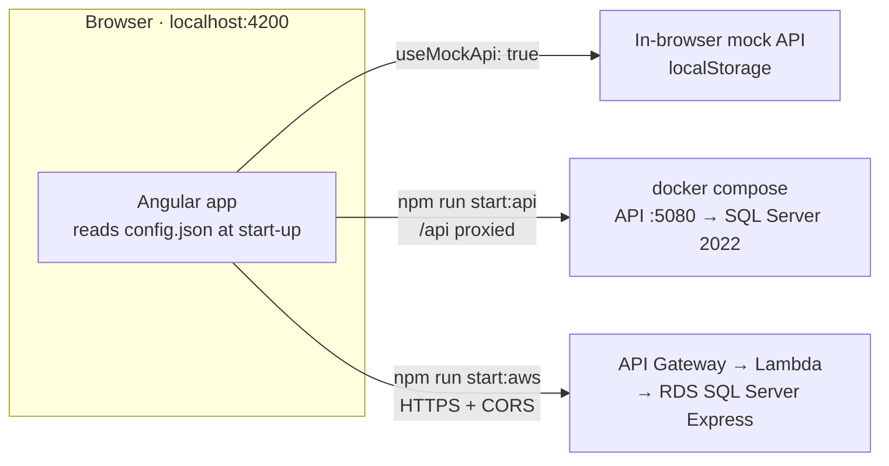

# Home Loan Pre-Qualification

A customer pre-qualifies for a home loan in two steps, **Loan details** then **About you**, and submits. Progress is saved as they type, so they can come back later. The stack:

- **Front end:** Angular 19.
- **API:** .NET 8 (ASP.NET Core minimal APIs) using **Dapper** on **SQL Server**.
- **AWS:** the API runs on **Lambda** as a container image, behind an HTTPS API Gateway, with RDS SQL Server.
- **Deploys:** automatic, by GitHub Actions on every push to `main`.

**Live API:** `https://wmq0xra270.execute-api.ap-southeast-2.amazonaws.com/api` (until it's torn down, see [Tear down](#tear-down)).
Design decisions, the database and AWS design, improvements and the use of AI tools are in **[NOTES.md](NOTES.md)**.



One front-end build runs against any of the three APIs: only `config.json` changes.

## Repository layout

| Path | What |
|---|---|
| [`frontend/`](frontend) | Angular app, in-browser mock API, Karma unit tests, Playwright journeys (`frontend/e2e`) |
| [`backend/`](backend) | .NET 8 solution: `Domain`, `Application`, `Infrastructure`, `Api`, `Migrations` (DbUp), `Secrets`, plus unit and integration tests |
| [`infra/`](infra) | AWS CDK (C#) stacks: GitHub OIDC, network and database, Lambda API; template tests |
| [`docs/plans/`](docs/plans) | The plan for each phase, written before the code, with "As built" notes |
| [`docs/ai-log.md`](docs/ai-log.md) | Every real case where AI output was wrong, and how it was caught |
| [`docker-compose.yml`](docker-compose.yml) | Local stack: SQL Server, then the migrator, then the API |
| [`.github/workflows/`](.github/workflows) | CI (checks, E2E, deploy) and the on-demand Destroy workflow |

## Prerequisites

| Tool | Version | Needed for |
|---|---|---|
| Node.js | 22 (`frontend/.nvmrc`; Angular 19 doesn't support 24) | Front end, Playwright, CDK CLI |
| .NET SDK | 8.0 | Back end, infra |
| Docker | Desktop 4.x, with **Rosetta enabled on Apple Silicon** (SQL Server only ships amd64) | Local stack, integration tests |
| AWS CLI + a `huskystudio` profile | v2 | Only for local CDK commands; CI deploys without keys |

## Run it locally

### 1. Front end on the in-browser mock (no back end needed)

```bash
cd frontend && nvm use && npm ci && npm start     # http://localhost:4200
```

### 2. The full stack: real API and SQL Server in Docker

```bash
cp .env.example .env                 # local-only passwords; .env is gitignored
docker compose up -d --build         # SQL Server → migrator (exits) → API on http://localhost:5080
cd frontend && npm run start:api     # http://localhost:4200, /api proxied to :5080
```

- **Check it:** `curl localhost:5080/health/ready`.
- **Swagger:** in Development (`cd backend && dotnet run --project src/HomeLoan.Api`), at `http://localhost:5080/swagger`.
- **Database login:** the API connects as the least-privilege login `homeloan_app`, never `sa`.

### 3. The front end against the deployed AWS API

```bash
scripts/write-aws-config.sh          # writes frontend/config/aws/config.json from the stack output
cd frontend && npm run start:aws     # http://localhost:4200 → https://…execute-api…/api
```

## Tests

| Suite | Command | What it proves |
|---|---|---|
| Front end lint and format | `cd frontend && npm run format:check && npm run lint` | Prettier and angular-eslint, with `OnPush` enforced |
| Front end unit (160) | `cd frontend && npm run test:ci` | Components, validators (age and mobile boundaries), store, ETag client, mock API, address suggestions, session, autosave (debounce, ordering, retry, the Continue race) |
| Journeys on the mock (13) | `cd frontend && npm run e2e` | Playwright: two applicants, Back keeps input, validation, "more than two", guard, address suggestions (Addressfinder stubbed), **closing the browser and coming back**, "Not you?", **submitting and starting again** |
| Journeys on the real stack (13) | `docker compose up -d --build`, then `cd frontend && E2E_CONFIGURATION=local-api npm run e2e` | The same journeys against the .NET API and SQL Server |
| Back end unit (103) | `cd backend && dotnet test tests/HomeLoan.UnitTests` | Domain rules, validators, handlers, ETags, secrets resolution, resume tokens, drafts |
| Back end integration (59) | `cd backend && dotnet test tests/HomeLoan.IntegrationTests` | Real SQL Server (Testcontainers): the HTTP contract, **concurrent-save races**, every schema constraint, least-privilege login, **the token on every route**, expiry, drafts, the purge |
| Infra (11) | `cd infra && dotnet test` | Synthesized CloudFormation: database private and encrypted, no internet route, secret scoping, OIDC trust, the daily purge |
| Lambda images | `backend/scripts/lambda-local-check.sh` (with Compose's SQL Server up) | Both Lambda images under AWS's Runtime Interface Emulator with real API Gateway events |
| Live API | `backend/scripts/smoke-test.sh <api-endpoint>` | End to end on AWS, on application `900001` |
| Cold starts | `scripts/measure-cold-start.sh [minutes] [parallel-requests]` | Init, first-request and per-phase start-up times of the live version, from CloudWatch |

CI runs all of these. On `main` it then deploys, and re-runs the smoke test and the 6 journeys against the live API.

## Deploy (automatic)

```mermaid
flowchart LR
    Push["git push main"] --> Checks
    subgraph Checks["CI (parallel)"]
        FE["Front end<br/>lint · unit · build"]
        BE["Back end<br/>unit · integration"]
        IN["Infra<br/>tests · offline synth"]
        E2E1["E2E on mock"]
        E2E2["E2E on docker compose"]
    end
    Checks --> OIDC["Sign in to AWS<br/>GitHub OIDC, no stored keys"]
    OIDC --> CDK["cdk deploy<br/>build + push arm64 images"]
    CDK --> Mig["Migrator Lambda<br/>runs before the new API"]
    Mig --> Live["API live"]
    Live --> Smoke["Smoke test"]
    Smoke --> E2E3["E2E against live API"]
```



- **When:** every push to `main` that passes all checks deploys. Deploys queue and are never cancelled midway.
- **Migrations:** a failed migration fails the CloudFormation deploy, so the previous version keeps serving.
- **One-time bootstrap** (already done for account `085843960390`, `ap-southeast-2`):
  - `infra/cdk.sh bootstrap`, then `infra/cdk.sh deploy HomeLoanGitHubOidc`;
  - create a GitHub environment named `aws` that only `main` may deploy to;
  - store the role ARN in the repo variable `AWS_DEPLOY_ROLE_ARN`.
- **`infra/cdk.sh`:** a wrapper that pins `AWS_PROFILE=huskystudio` and refuses to run against any other account.

## Tear down

Run **Actions → "Destroy AWS environment" → Run workflow**, and type `destroy`. That removes the API and the database, data included. The bootstrap and OIDC stacks stay (they cost cents a month), so the next push to `main` redeploys from scratch.

To remove everything, after running Destroy:

```bash
infra/cdk.sh destroy HomeLoanGitHubOidc
```

Then delete the `CDKToolkit` stack, its S3 bucket and its ECR repository in the console.

## Known limitations

- There is no sign-in. Each browser gets its own application, reached only with the resume token kept in that browser's `localStorage`, so another device can't continue it. NOTES → Decisions and Improvements.
- Cold starts: one provisioned instance keeps the API warm, so one-at-a-time traffic has none. A request that needs a second instance takes about 1.35 s (it was about 2 s, and about 7 s right after a deploy). Measured numbers are in NOTES. The provisioned instance costs about US$15–20/month; set `apiProvisionedConcurrency` to `0` in `infra/cdk.json` to turn it off.
